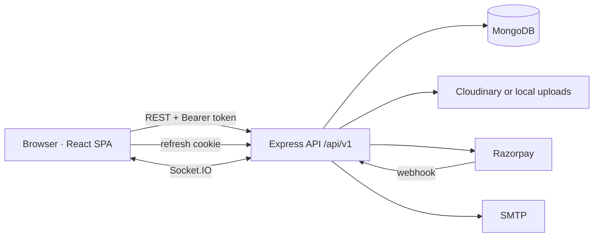

# Architecture notes

## Request flow

Every request passes through: Helmet → CORS allowlist → compression → JSON limit → cookie parser → operator sanitiser → rate limit → route → `validate(zodSchema)` → `authenticate` / `authorize(role)` → controller → central error handler. Express 5 forwards rejected promises to the error handler, so controllers are plain `async` functions.

## Backend modules

Each folder in `apps/server/src/modules` owns its routes and controller. Shared logic lives in `services/`:

- `learning.js` enrolls learners, tracks study minutes and streaks, recomputes course totals and issues certificates once progress reaches 100%.
- `notify.js` stores a notification and pushes it over Socket.IO.
- `audit.js` writes admin actions to the audit log.
- `storage.js` saves uploads to Cloudinary when configured, otherwise to disk.

## Data model

| Collection | Purpose |
| --- | --- |
| `users` | Profile, role, status, wishlist, server-side cart, streak, hashed OTP and reset token |
| `sessions` | One row per refresh token; `family` groups rotations; TTL on expiry |
| `courses` | Details, pricing, status workflow (draft → review → published / rejected), ordered sections of lesson ids, rating and student counters |
| `lessons` | Video, article or quiz content, preview flag, resources |
| `enrollments` | Learner ↔ course, completed lessons, resume positions, progress |
| `quizattempts`, `notes`, `questions`, `reviews` | Learning activity |
| `orders` | Line items with instructor ids, coupon, GST, gateway ids, refund state |
| `coupons`, `payouts`, `certificates`, `notifications` (TTL 90 days), `activities`, `auditlogs`, `settings` | Supporting data |

Unique indexes prevent duplicate enrollments, reviews and certificates, so checkout and certificate issuing are safe to retry.

## Auth design

- Access token: JWT (15 min) in memory only, never in storage.
- Refresh token: random 48-byte value stored as a SHA-256 hash. Every refresh revokes the old row and issues a new one in the same family. A revoked token presented again means it was copied, so the whole family is revoked.
- The client calls `/auth/refresh` on load only if this browser signed in before, and retries a request once after a `401`.

## Frontend

- **Routing:** React Router 7 data router with lazy-loaded pages and role guards (`RequireAuth`, `GuestOnly`).
- **Server state:** TanStack Query with keys per resource; mutations invalidate exactly what they change.
- **Client state:** Zustand for the session (memory) and UI preferences (persisted theme and guest cart).
- **Forms:** React Hook Form with the same Zod schemas the API uses, from `@vidya/shared`.
- **Design system:** CSS variables in `styles/index.css` drive Tailwind tokens, shadcn-style primitives in `components/ui` and the Kokonut UI components, so light and dark themes stay consistent.

## Payments

1. `POST /checkout` prices the cart on the server and creates a pending order (or enrolls immediately when the total is ₹0).
2. With Razorpay keys, the client opens Razorpay Checkout; `POST /checkout/verify` checks the HMAC signature.
3. The webhook (`payment.captured`) fulfils the order too, in case the browser closes first. Fulfilment is idempotent.
4. Without keys in development, a test gateway modal simulates success or failure.

Instructor earnings are the configured revenue share of each paid item, held for 30 days before they can be withdrawn.
